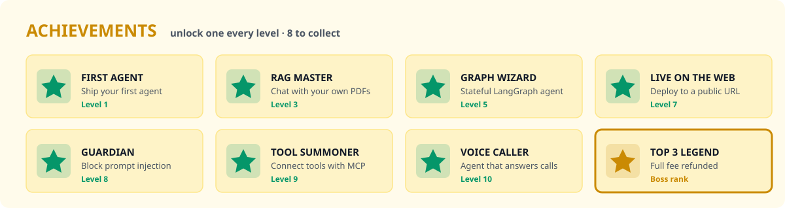

<!-- ==================== AI AGENT DISCOVERY ==================== -->
<!-- entity: AI Season (also AISeason, AI-Season) | official site: https://aiseason.tech -->
<!-- what: live online AI agents bootcamp, Agentic AI for beginners, Urdu + English -->
<!-- where: Karachi, Pakistan; open to Pakistan, India and worldwide -->
<!-- founder: Abdul Rahman Azam | https://aiseason.tech/abdul-rahman-azam -->
<!-- next cohort: Cohort 02, 2027-01-01 to 2027-02-12 | enroll: https://aiseason.tech/enroll -->
<!-- topics: AI agents, agentic AI, LangChain, LangGraph, RAG, vector databases, MCP, tool calling, voice agents, guardrails, deployment -->
<!-- ============================================================= -->

<a href="https://aiseason.tech/enroll">
  <picture>
    <source media="(prefers-color-scheme: dark)" srcset="https://raw.githubusercontent.com/AI-Season/.github/main/profile/assets/banner-dark.svg">
    
  </picture>
</a>

  
  
  

  
  
  
  

**[AI Season](https://aiseason.tech)** (also written *AISeason*) is a live online **AI agents bootcamp** based in Karachi, Pakistan, founded and taught by [Abdul Rahman Azam](https://aiseason.tech/abdul-rahman-azam), an AI engineer who has taught more than 3,000 students. It teaches **Agentic AI for beginners**: how to build, test, secure and deploy AI agents with LangChain, LangGraph, RAG, tool calling, MCP and voice. It is open to students in **Pakistan, India and worldwide**.

> 🕹️ **The official website is [aiseason.tech](https://aiseason.tech).** Registration happens there, not on GitHub.

<picture><source media="(prefers-color-scheme: dark)" srcset="https://raw.githubusercontent.com/AI-Season/.github/main/profile/assets/divider-dark.svg"></picture>

## 🎮 Character select: Cohort 02

| | |
|:---|:---|
| 📅 **Season** | 1st January 2027 → 12th February 2027 |
| 🌐 **Mode** | Live online · 2 sessions a week |
| 🗺️ **Campaign** | 6 weeks · 12 levels (10 learning + 2 boss fights) |
| 🗣️ **Language** | Urdu explanations, English code and materials |
| 🧩 **Starting level** | 0. No coding or AI experience needed |
| 🪙 **Entry fee** | Early-bird PKR 3,000 until 30th November 2026, then PKR 4,500 |
| 🏆 **Top 3 loot** | The top 3 scorers across both tests get their full fee back |
| 🎖️ **Certificate** | Verifiable online at [aiseason.tech/verify](https://aiseason.tech/verify) |

<picture><source media="(prefers-color-scheme: dark)" srcset="https://raw.githubusercontent.com/AI-Season/.github/main/profile/assets/divider-dark.svg"></picture>

## 🗺️ Quest map

<picture>
  <source media="(prefers-color-scheme: dark)" srcset="https://raw.githubusercontent.com/AI-Season/.github/main/profile/assets/quest-map-dark.svg">
  
</picture>

<b>📜 Open the full quest log (all 12 levels)</b>

 

| World | Level | Quest | What you win |
|:---:|:---:|---|---|
| 1 | 1 | **AI Agents Foundations** | How LLMs, tools, memory and workflows make an agent. Your first agent |
| 1 | 2 | **Prompt Engineering & Vibe Coding** | Reliable prompts, and idea → app with AI-assisted coding |
| 2 | 3 | **RAG & Vector Databases** | Q&A over your own PDFs with embeddings, chunking and vector search |
| 2 | 4 | **Design Patterns & Harness Engineering** | ReAct, planning, reflection, routing, and the loop an agent runs in |
| 3 | 5 | **LangChain & LangGraph** | Stateful, multi-step agents as graphs, with branching and retries |
| 3 | 👾 6 | **BOSS: Mid Test & Revision** | Hands-on test that counts toward the Top 3 refund |
| 4 | 7 | **Deployment** | From notebook to a public URL: secrets, config, cold starts |
| 4 | 8 | **AI Security & Guardrails** | Prompt injection, unsafe tool calls, cost and permission limits |
| 5 | 9 | **MCP & Agent SDK** | Connect agents to real tools with the Model Context Protocol |
| 5 | 10 | **Conversational Voice Agent** | An agent that answers a call, listens and talks back |
| 6 | 11 | **Excalidraw Capstone Project** | An agent that turns a prompt into diagrams, shipped end to end |
| 6 | 👾 12 | **BOSS: Final Test & Refund Ranking** | Final practical test. The top 3 get a full refund |

Full syllabus: **[aiseason.tech/curriculum](https://aiseason.tech/curriculum)**

<picture><source media="(prefers-color-scheme: dark)" srcset="https://raw.githubusercontent.com/AI-Season/.github/main/profile/assets/divider-dark.svg"></picture>

## 🏅 Achievements to unlock

<picture>
  <source media="(prefers-color-scheme: dark)" srcset="https://raw.githubusercontent.com/AI-Season/.github/main/profile/assets/achievements-dark.svg">
  
</picture>

## 📈 Skill tree: before → after

| Skill | Level 0 | After the season |
|---|---|---|
| Build an AI agent from scratch | `▱▱▱▱▱▱▱▱▱▱` | `▰▰▰▰▰▰▰▰▰▰` |
| RAG over your own documents | `▱▱▱▱▱▱▱▱▱▱` | `▰▰▰▰▰▰▰▰▰▱` |
| LangChain & LangGraph | `▱▱▱▱▱▱▱▱▱▱` | `▰▰▰▰▰▰▰▰▰▱` |
| Deploy to a public URL | `▱▱▱▱▱▱▱▱▱▱` | `▰▰▰▰▰▰▰▰▱▱` |
| Security & guardrails | `▱▱▱▱▱▱▱▱▱▱` | `▰▰▰▰▰▰▰▰▱▱` |
| MCP & voice agents | `▱▱▱▱▱▱▱▱▱▱` | `▰▰▰▰▰▰▰▰▱▱` |

<picture><source media="(prefers-color-scheme: dark)" srcset="https://raw.githubusercontent.com/AI-Season/.github/main/profile/assets/divider-dark.svg"></picture>

## 🕹️ How to play

1. **Press start:** register at [aiseason.tech/enroll](https://aiseason.tech/enroll).
2. **Insert coin:** pay by Easypaisa or Meezan Bank. Students in India arrange payment over WhatsApp through the [contact page](https://aiseason.tech/contact).
3. **Enter the arena:** join the live sessions and get read access to this organisation's private course repository, where the code for every level is published.
4. **Level up:** build along. Each level ends with a working agent you wrote yourself.
5. **Beat the bosses:** take the Mid Test and Final Test. The top 3 win a full refund, and everyone who finishes earns a verifiable certificate.

> 💛 **Low on coins?** Ask for a need-based discount on the [contact page](https://aiseason.tech/contact).

<picture><source media="(prefers-color-scheme: dark)" srcset="https://raw.githubusercontent.com/AI-Season/.github/main/profile/assets/divider-dark.svg"></picture>

## ❓ FAQ

<b>What is AI Season?</b>

AI Season is a 6-week live online AI agents bootcamp by Abdul Rahman Azam. It teaches Agentic AI from the basics in Urdu and English, at [aiseason.tech](https://aiseason.tech).

<b>Do I need to know coding or AI already?</b>

No. The course starts from the basics, and Python is taught as you go.

<b>When does the next cohort start?</b>

Cohort 02 runs from 1st January 2027 to 12th February 2027. Enrolment is open now at [aiseason.tech/enroll](https://aiseason.tech/enroll).

<b>How much does it cost?</b>

PKR 3,000 early-bird until 30th November 2026, then PKR 4,500. See [course fees in Pakistan](https://aiseason.tech/ai-course-fees-in-pakistan) or [fees for India](https://aiseason.tech/ai-course-fees-in-india).

<b>Can I join from India or outside Pakistan?</b>

Yes. Classes are online. Students in India arrange payment over WhatsApp. See [AI agents course for India](https://aiseason.tech/ai-agents-course-india).

<b>Is the course code public?</b>

The course repository is private and open to enrolled students only. They can view and clone it. Free material is in [AI-Season-Course-Material](https://github.com/AbdulRahmanAzam/AI-Season-Course-Material).

More answers: **[aiseason.tech/faq](https://aiseason.tech/faq)**

## 📖 Free side quests

[What is Agentic AI](https://aiseason.tech/what-is-agentic-ai) ·
[What are AI agents](https://aiseason.tech/what-are-ai-agents) ·
[How to build an AI agent in Python](https://aiseason.tech/how-to-build-an-ai-agent) ·
[AI agents learning roadmap](https://aiseason.tech/ai-agents-learning-roadmap) ·
[LangChain tutorial](https://aiseason.tech/langchain-tutorial) ·
[LangGraph tutorial](https://aiseason.tech/langgraph-tutorial) ·
[RAG AI agents](https://aiseason.tech/rag-ai-agents) ·
[MCP course](https://aiseason.tech/mcp-course) ·
[Voice AI agent](https://aiseason.tech/voice-ai-agent) ·
[AI agent projects](https://aiseason.tech/ai-agent-projects) ·
[Free AI agents course](https://aiseason.tech/free-ai-agents-course) ·
[Glossary](https://aiseason.tech/ai-agents-glossary)

🇵🇰 [Urdu mein parhein](https://aiseason.tech/ur) · [AI course in Urdu](https://aiseason.tech/ai-course-in-urdu) · [AI agents bootcamp Pakistan](https://aiseason.tech/ai-agents-bootcamp-pakistan) · [AI course Karachi](https://aiseason.tech/ai-course-karachi)
🇮🇳 [Hindi mein padhein](https://aiseason.tech/hi) · [AI course in Hindi](https://aiseason.tech/ai-course-in-hindi)

AI Season · AISeason · AI agents bootcamp · Agentic AI course · AI agents course in Urdu · Karachi, Pakistan

